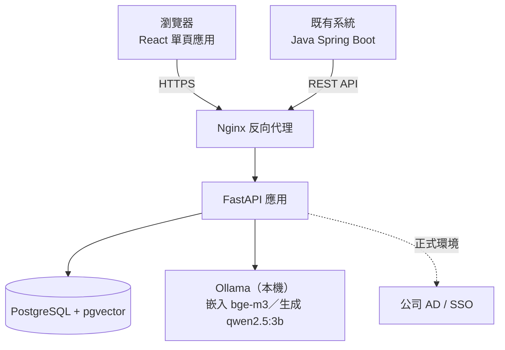
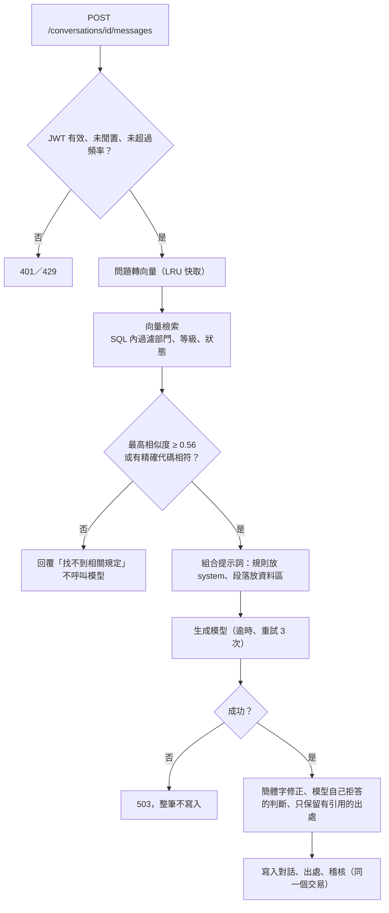

# 內部知識助理（Internal Knowledge Assistant）

讓企業各部門員工用自然語言查詢內部法規與 SOP 的 RAG 系統：答案附出處、找不到就明說、依部門與機密等級控管可見範圍。嵌入與生成模型都在本機執行，文件不離開主機。

> **這是 `reference` 分支：完整實作版**，作為對照與參考。`main` 分支是同一個專案的骨架，業務邏輯留給自己實作。
> 對照某個檔案的完整寫法：`git diff main reference -- backend/app/core/bm25.py`

## 目錄

- [對應職缺需求](#對應職缺需求)
- [功能](#功能)
- [系統架構](#系統架構)
- [評測結果](#評測結果)
- [設計決策](#設計決策)
- [快速開始](#快速開始)
- [測試](#測試)
- [API](#api)
- [資料表](#資料表)
- [資料來源](#資料來源)
- [已知限制與後續](#已知限制與後續)

## 對應職缺需求

目標職缺類型：製造業內部 IT 的 AI 應用與後端整合工程師。

| 職缺要求 | 本專案的實作 | 位置 |
|---|---|---|
| 企業內部 AI 知識庫、RAG 應用開發 | 依條切塊（含子條號）、向量檢索、BM25、加權 RRF、拒答規則、出處 | `backend/app/core/`、`services/rag.py` |
| LLM API 串接 | 模型服務層：逾時、指數退避重試、錯誤分類、可替換模型 | `core/llm_service.py` |
| Backend API／微服務、高效能 RESTful API（FastAPI） | 22 個資源導向端點、統一錯誤格式、分頁、背景處理、限流 | `backend/app/routers/` |
| 與既有系統（Java Spring Boot）串接 | OpenAPI 規格作為合約：`/api/v1/openapi.json` | `backend/app/main.py` |
| PostgreSQL、SQL 撰寫與資料處理 | pgvector（HNSW）、權限過濾寫在檢索 SQL 內、兩版 Alembic 遷移 | `models/`、`core/retriever.py`、`migrations/` |
| OAuth 2.0 身分驗證、JSON 資料解析 | OAuth2 password flow、JWT、refresh token 輪替與重用偵測 | `routers/auth.py`、`services/auth.py` |
| 跨部門使用、資料安全 | 部門 × 角色 × 文件等級；稽核紀錄；登入鎖定；閒置登出 | `core/retriever.py`、`services/audit.py` |
| Docker 容器化打包與部署 | Compose：PostgreSQL＋API＋Nginx；整套實際部署驗證過 | `docker-compose.yml`、`nginx/` |
| Linux 操作、Shell Script | 資料庫備份、輪替保留份數、還原驗證 | `scripts/backup.sh` |
| 獨立除錯（Troubleshooting） | 79 項自動測試；評測找出的問題與修正見「評測結果」 | `backend/tests/` |
| 主動追蹤 AI 技術並評估內部應用 | 檢索方式比較、權重與門檻校準，依數據決定預設值 | `services/eval.py`、`scripts/run_eval.py` |

## 功能

**員工**
- 對話式問答，答案附文件名稱、條號（含「第 15-1 條」這類子條號）、版本、相似度
- 查不到依據時回答「找不到相關規定」，不呼叫模型編造
- 只看得到公開文件、自己部門的文件；主管另可看本部門的限閱文件
- 對話紀錄、刪除對話、對回答標記有用／沒用
- 15 分鐘沒有操作自動登出

**IT 管理員**（同一個單頁應用中的管理面板）
- 文件：上傳（.txt、.md、.pdf）、背景處理狀態、修改等級、重新處理、作廢
- 使用者：調整部門、角色、停用帳號（立即生效）
- 成效：執行評測，看 Hit@1／Hit@3／MRR／拒答正確率／越權測試／耗時，以及逐題失敗案例
- 稽核：登入、提問、文件與帳號異動紀錄（不含提問與文件內容）

## 系統架構



| 層 | 目錄 | 責任 |
|---|---|---|
| 路由層 | `app/routers/` | HTTP：參數、狀態碼、回應格式 |
| 服務層 | `app/services/` | 業務邏輯與交易 |
| 基礎層 | `app/core/` | 演算法（BM25、RRF、LRU、Token Bucket、切塊）與模型、檢索的封裝 |

### 問答流程



## 評測結果

測試集：`data/eval_cases.csv`，47 題，包含：

- 應回答 35 題：法規題、模擬 SOP 題、換句話說的題目、代碼與分機這類精確字詞題
- 應拒答 7 題：文件中沒有答案
- 越權 5 題：答案在提問者沒有權限的文件裡

文件為 3 部法規＋9 份模擬內部文件，共 211 個段落。嵌入模型 bge-m3，前 5 名。

| 檢索方式 | 關鍵字權重 | Hit@1 | Hit@3 | MRR | 誤拒率 | 拒答正確率 | 越權通過 | 外洩 | p95 |
|---|---|---|---|---|---|---|---|---|---|
| **向量（預設）** | — | **94%** | **100%** | **0.97** | 0% | 86% | 100% | 0 | 94 ms |
| 混合 | 0.3 | 91% | 100% | 0.95 | 0% | 86% | 100% | 0 | 171 ms |
| 混合 | 0.5 | 91% | 97% | 0.94 | 0% | 86% | 100% | 0 | 219 ms |
| 混合 | 1.0 | 86% | 97% | 0.90 | 0% | 86% | 100% | 0 | 390 ms |
| 關鍵字 | — | 86% | 91% | 0.89 | 0% | 86% | 100% | 0 | 280 ms |

耗時是在本機（無 GPU）執行；Docker 部署時模型呼叫要經過主機網路，p95 約 370 ms。

### 從評測得到的決定

1. **預設改用純向量檢索。** 原本的設計是等權重的混合檢索，但評測顯示 BM25 的雜訊會把正確條文擠出前幾名（Hit@1 從 94% 掉到 86%）。降低關鍵字權重能改善，但仍不如純向量。混合檢索保留為設定（`SEARCH_MODE=hybrid`），文件中料號、代碼很多時再評測一次。
2. **拒答門檻定為 0.56。** 除了下一點的精確代碼題，應回答題的最高相似度最低是 0.57；應拒答題最高是 0.60。0.56 是誤拒率 0% 下拒答最多的切點。門檻是用這 47 題校準的，題目或文件改變後要重新校準：`python -m scripts.run_eval --thresholds 0.5 0.56 0.6`。
3. **精確字詞也算證據。** 「ECN是什麼」「分機1199是誰的電話」這類短問題，向量相似度只有 0.45–0.47，單看門檻會被誤拒。所以問題中 3 個字元以上的英數代碼若出現在段落裡，就不拒答。
4. **兩道拒答防線。** 剩下的失敗案例是「公司訪客 Wi-Fi 的密碼」（0.60，對到密碼規則條文）。檢索層放行後，模型讀到的資料裡沒有 Wi-Fi 密碼，回答「找不到相關規定。」，系統據此標記為拒答。這一步實際測試過。
5. **權限零外洩。** 越權題由兩種獨立的方式檢查：SQL 過濾，以及評測裡的 Python 權限判斷。所有題目的結果都沒有出現沒權限的段落。

## 設計決策

| 問題 | 決定 | 理由 |
|---|---|---|
| 模型放哪裡 | 本機 Ollama（bge-m3、qwen2.5:3b） | 內部機密文件不送外部；模型服務層可換成雲端 API |
| 權限在哪裡擋 | 檢索 SQL 的 WHERE 條件 | 沒權限的段落不會進排名、不會進提示詞，不靠「叫模型別說」 |
| 怎麼切塊 | 依「第N條」，含「第 N-M 條」子條號；沒有條號的文件改用滑動視窗 | 引用單位就是條；章節標題與已刪除條文略過 |
| 向量存哪裡 | PostgreSQL＋pgvector | 權限過濾與向量搜尋同一句 SQL；少維護一套服務 |
| 模型回答出現簡體字 | 只轉換「資料中沒出現過」的字 | 整句轉換會把法規原文的「雇主」改成「僱主」 |
| 模型失敗 | 回 503、提問與回答都不寫入；前端把文字還給使用者 | 不留下只有提問沒有回答的對話 |
| refresh token | 只存雜湊、每次使用就輪替；舊的被重複使用時撤銷此人全部權杖 | 偵測權杖被複製；前端同時只送一個 refresh，避免誤判 |
| 權限與角色變更 | 每個請求都以資料庫中的使用者為準 | 停用帳號、改角色立即生效，不必等 JWT 過期 |
| 登入失敗 | 帳號不存在與密碼錯誤回同一訊息、同樣耗時；連續 5 次鎖 15 分鐘 | 防帳號列舉與暴力猜測 |
| 稽核 | 與業務變更同一個交易寫入；不記提問與文件內容 | 不會有「做了卻沒紀錄」；紀錄本身不洩密 |
| 文件處理 | 上傳回 202，背景切塊與向量化；重新處理具冪等性，內容沒變的段落沿用舊向量 | 大文件不卡住請求；重做不會重複計費或重複資料 |
| 已作廢文件 | 不刪除、不可重新處理，檢索排除 | 保留稽核軌跡；要恢復請上傳新版本 |
| 出處 | 存引用當下的文件名稱、版本、條號快照 | 文件重新處理後，舊對話的出處仍看得到 |
| 限流 | 每位使用者每分鐘 20 次提問（Token Bucket） | 生成成本高；限制：多個 worker 時要改放 Redis |

## 快速開始

需求：Python 3.12、Node.js 20 以上、Docker Desktop、[Ollama](https://ollama.com)。

**1. 模型與設定**

```bash
ollama pull bge-m3
```

```bash
ollama pull qwen2.5:3b
```

```bash
cp .env.example .env
```

編輯 `.env`，把資料庫密碼（兩處）與 `JWT_SECRET` 換成自己的隨機字串。

**2. 資料庫**

```bash
docker compose up -d db
```

**3. 後端**（在 `backend/` 下）

```bash
python -m venv .venv
```

```bash
.venv\Scripts\activate
```

```bash
pip install -r requirements.txt
```

```bash
alembic upgrade head
```

```bash
python -m scripts.seed
```

```bash
python -m scripts.import_docs
```

```bash
python -m scripts.create_admin --email it@example.com
```

```bash
python -m scripts.load_eval_cases
```

```bash
uvicorn app.main:app --reload
```

`import_docs` 會依 `data/manifest.csv` 匯入 12 份文件（無 GPU 約 3 分鐘）。法規全文已附在 `data/raw/laws/`，要更新成最新版本可執行 `python -m scripts.fetch_laws`。API 文件：<http://127.0.0.1:8000/api/v1/docs>

**4. 前端**（在 `frontend/` 下）

```bash
npm install
```

```bash
npm run dev
```

開啟 <http://localhost:5173>，用 IT 管理員帳號登入，或在登入頁註冊一般員工帳號。後端不在 8000 埠時，在 `frontend/.env.local` 設定 `API_PROXY_TARGET=http://127.0.0.1:<埠號>`。

**整套用 Docker 部署**

```bash
cd frontend && npm run build && cd .. && docker compose up -d --build
```

```bash
docker compose exec api python -m scripts.seed
```

```bash
docker compose exec api python -m scripts.import_docs
```

```bash
docker compose exec api python -m scripts.create_admin --email it@example.com
```

開啟 <http://localhost:8080>。本機已有服務占用 5432 或 8080 時，在 `.env` 設定 `DB_PORT`、`WEB_PORT`。

**評測與備份**

```bash
python -m scripts.run_eval --modes vector hybrid keyword --failures
```

```bash
bash scripts/backup.sh
```

## 測試

在 `backend/` 下：

| 指令 | 內容 | 題數 |
|---|---|---|
| `pytest tests/spec` | 演算法與元件規格（切塊、BM25、RRF、LRU、限流、雜湊與 JWT、重試、評測指標） | 35 |
| `pytest tests/test_infra.py tests/test_retrieval_rules.py` | 端點註冊、錯誤格式、拒答規則、子條號、簡繁修正 | 16 |
| `pytest -m db` | 整合測試：登入、權杖輪替與重用偵測、閒置、鎖定、權限過濾、問答、模型故障、文件處理、評測、稽核、遷移一致性 | 28 |

整合測試使用獨立的測試資料庫（原資料庫名稱加上 `_test`，自動建立），模型換成假的（`tests/fakes.py`），不需要 Ollama。

## API

前綴 `/api/v1`。完整規格見 `/api/v1/docs`。

| 方法 | 路徑 | 說明 | 成功 | 權限 |
|---|---|---|---|---|
| POST | `/auth/token` | 登入或更新權杖（`grant_type`＝`password`／`refresh_token`） | 200 | 公開 |
| POST | `/auth/revoke` | 撤銷 refresh token | 204 | 登入 |
| POST | `/users` | 註冊 | 201 | 公開 |
| GET | `/users` | 使用者列表 | 200 | IT |
| PATCH | `/users/{id}` | 修改部門、角色、啟用狀態 | 200 | IT |
| GET | `/me` | 目前使用者 | 200 | 登入 |
| GET | `/departments` | 部門列表 | 200 | 公開 |
| POST | `/conversations` | 新增對話 | 201 | 登入 |
| GET | `/conversations` | 自己的對話列表 | 200 | 登入 |
| DELETE | `/conversations/{id}` | 刪除自己的對話 | 204 | 登入 |
| GET | `/conversations/{id}/messages` | 對話內的訊息與出處 | 200 | 登入 |
| POST | `/conversations/{id}/messages` | 提問，回傳 AI 回覆（每分鐘有次數上限） | 201 | 登入 |
| PUT | `/messages/{id}/feedback` | 設定有用／沒用 | 200 | 登入 |
| GET | `/documents` | 文件列表 | 200 | IT |
| POST | `/documents` | 上傳文件（背景處理） | 202 | IT |
| GET | `/documents/{id}` | 單一文件與段落數 | 200 | IT |
| PATCH | `/documents/{id}` | 修改等級或作廢 | 200 | IT |
| POST | `/documents/{id}/processing-jobs` | 重新處理 | 202 | IT |
| POST | `/eval-runs` | 執行評測（背景） | 202 | IT |
| GET | `/eval-runs` | 評測批次與指標 | 200 | IT |
| GET | `/eval-runs/{id}/results` | 逐題結果，`?failed_only=true` 只看失敗 | 200 | IT |
| GET | `/audit-logs` | 稽核紀錄 | 200 | IT |
| GET | `/health`、`/health/db`、`/health/llm` | 服務、資料庫、模型是否正常 | 200 | 公開 |

錯誤一律為 `{"code": "...", "message": "..."}`；列表一律為 `{"items": [...], "total": n, "limit": n, "offset": n}`。

## 資料表

| 資料表 | 用途 |
|---|---|
| `departments` | 部門，權限的基本單位 |
| `users` | 帳號、所屬部門、角色、最後活動時間、登入失敗次數與鎖定時間 |
| `refresh_tokens` | 更新權杖（只存雜湊），可撤銷 |
| `documents` | 文件的一個版本：等級、狀態、切塊方式（依條／滑動視窗） |
| `chunks` | 段落、條號與子條號、內容雜湊、向量（HNSW 索引） |
| `conversations`、`messages` | 對話與訊息（含是否拒答、耗時、回饋） |
| `message_citations` | 回覆引用的段落，另存引用當時的文件名稱、版本、條號 |
| `audit_logs` | 稽核紀錄，只增不改 |
| `eval_cases`、`eval_runs`、`eval_results` | 評測題目、批次設定、逐題結果（題型、名次、是否外洩、實際第一名） |

遷移：`20261114_initial_schema`（12 張表）→ `20261115_lockout_subarticles_eval`（登入鎖定、子條號、切塊方式、出處文字、評測細節）。

## 資料來源

| 類別 | 內容 | 來源 |
|---|---|---|
| 法規 | 職業安全衛生法、危害性化學品標示及通識規則、廢棄物清理法 | 全國法規資料庫（`scripts/fetch_laws.py` 擷取，檔案內記錄修正日期與擷取日期） |
| 內部文件 | 化學品管理、廢棄物處理、緊急應變、設計文件管制、報價審核、差旅報支、資訊安全、營業秘密、助理使用說明 | `data/raw/mock/`：為示範自行撰寫的模擬資料，非任何公司的真實規定 |

法律、命令依著作權法第 9 條不是著作權的標的。法規可能修正，使用前請以全國法規資料庫的現行版本為準。

## 已知限制與後續

- 限流與關鍵字索引放在行程記憶體中；多個 worker 或多台主機時要改放 Redis，或改用 PostgreSQL 全文檢索。
- 文件處理用 FastAPI 的背景工作，服務重啟時正在處理的文件會停在「處理中」；量大時改用工作佇列（例如 Celery、RQ）。
- 無 GPU 時生成一則回答約 5–30 秒；可換更小的模型、限制輸出長度，或改用串流回應。
- 評測只有 47 題，門檻與預設檢索方式是用這批題目決定的；文件與題目增加後要重新評測。
- 後續：以 OIDC 接公司 AD／SSO、既有系統以 client credentials 呼叫、ERP 唯讀查詢 Agent、PostgreSQL Row Level Security、重排序模型。
