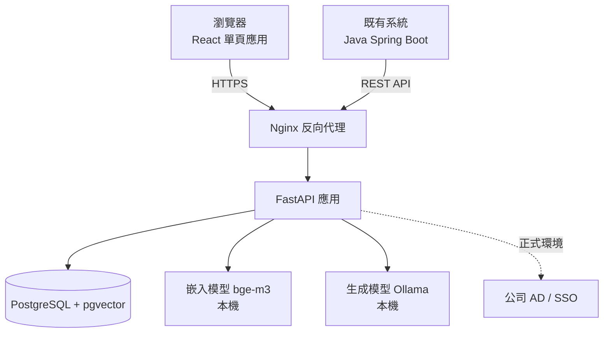
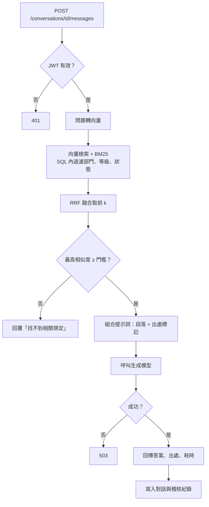

# 內部知識助理（Internal Knowledge Assistant）

讓企業各部門員工用自然語言查詢內部法規與 SOP 的 RAG 系統：答案附出處、找不到就明說、依部門與機密等級控管可見範圍，模型在本機執行，資料不離開主機。

> **目前狀態：專案骨架。** 架構、資料表、API 端點、部署設定、前端外殼與規格測試已完成；業務邏輯（標示 `TODO` 的函式）尚未實作，呼叫時 API 會回 `501` 並指出是哪個函式。

## 對應職缺需求

目標職缺類型：製造業內部 IT 的 AI 應用與後端整合工程師。

| 職缺要求 | 本專案對應的技術 | 位置 | 狀態 |
|---|---|---|---|
| 企業內部 AI 知識庫、RAG 應用開發 | 依條切塊、向量檢索、BM25、RRF 融合、拒答門檻、出處 | `backend/app/core/{chunker,bm25,rrf,retriever}.py`、`services/rag.py` | 待實作 |
| LLM API 串接 | 模型服務層：逾時、重試、錯誤隔離、可替換模型 | `backend/app/core/llm_service.py` | 待實作 |
| Backend API／微服務、高效能 RESTful API（FastAPI） | 22 個資源導向端點、統一錯誤格式、分頁、OpenAPI 文件 | `backend/app/routers/`、`schemas.py`、`errors.py` | 端點完成，邏輯待實作 |
| 與既有系統（Java Spring Boot）串接 | 以 OpenAPI 規格作為合約：`/api/v1/openapi.json` | `backend/app/main.py` | 完成 |
| PostgreSQL、SQL 撰寫與資料處理 | 12 張表、約束、索引、pgvector HNSW、Alembic 遷移 | `backend/app/models/`、`backend/migrations/` | 結構完成，查詢待實作 |
| API 整合經驗（OAuth 2.0 身分驗證、JSON） | OAuth2 password flow、JWT、refresh token 輪替與撤銷、閒置登出 | `routers/auth.py`、`core/security.py`、`services/auth.py` | 端點完成，邏輯待實作 |
| 跨部門使用、資料安全 | 部門 × 角色 × 文件等級的權限，在檢索 SQL 內過濾；稽核紀錄 | `core/retriever.py`、`services/audit.py` | 待實作 |
| Docker 容器化打包與部署 | Docker Compose：PostgreSQL＋API＋Nginx | `docker-compose.yml`、`backend/Dockerfile`、`nginx/` | 完成 |
| Linux 操作、Shell Script | 資料庫備份腳本 | `scripts/backup.sh` | 待實作 |
| 獨立除錯能力 | 規格測試（先讀測試、實作、跑到通過） | `backend/tests/spec/` | 測試完成 |
| 效能與資料結構 | LRU 快取、Token Bucket 限流、最小堆取前 k | `core/{lru_cache,rate_limiter,bm25}.py` | 待實作 |
| Git 版本控制 | 本 repo | — | — |

## 系統架構



後端分三層，只允許上層呼叫下層：

| 層 | 目錄 | 責任 |
|---|---|---|
| 路由層 | `app/routers/` | HTTP：參數、狀態碼、回應格式 |
| 服務層 | `app/services/` | 業務邏輯與交易 |
| 基礎層 | `app/core/` | 演算法與外部服務封裝 |

### 問答流程



## 目錄結構

```
├─ docker-compose.yml        db、api、nginx
├─ .env.example              設定範本
├─ db/init/                  資料庫初始化（啟用 pgvector）
├─ nginx/                    反向代理設定
├─ backend/
│  ├─ app/
│  │  ├─ main.py             應用程式進入點
│  │  ├─ config.py  db.py  deps.py  errors.py  schemas.py
│  │  ├─ models/             資料表
│  │  ├─ routers/            API 端點
│  │  ├─ services/           業務邏輯（TODO）
│  │  └─ core/               演算法與模型封裝（TODO）
│  ├─ migrations/            Alembic 遷移檔
│  ├─ scripts/seed.py        部門種子資料
│  └─ tests/
│     ├─ test_infra.py       骨架測試（現在就通過）
│     ├─ test_db.py          需要資料庫的測試
│     └─ spec/               規格測試（實作完成後才會通過）
├─ frontend/                 React + Vite
├─ scripts/backup.sh         資料庫備份（TODO）
└─ data/                     模擬 SOP、評測題目
```

## 快速開始

需求：Python 3.12、Node.js 20 以上、Docker Desktop。

```bash
cp .env.example .env
```

編輯 `.env`，把 `POSTGRES_PASSWORD`、`DATABASE_URL` 內的密碼、`JWT_SECRET` 換成自己的值。

**資料庫**

```bash
docker compose up -d db
```

**後端**（在 `backend/` 下）

```bash
python -m venv .venv
```

```bash
.venv\Scripts\activate
```

```bash
pip install -r requirements.txt
```

```bash
alembic upgrade head
```

```bash
python -m scripts.seed
```

```bash
uvicorn app.main:app --reload
```

API 文件：<http://127.0.0.1:8000/api/v1/docs>

**前端**（在 `frontend/` 下）

```bash
npm install
```

```bash
npm run dev
```

開啟 <http://localhost:5173>。後端邏輯完成前，可用 <http://localhost:5173/?demo> 以假資料預覽對話畫面。

**整套以容器啟動**

```bash
cd frontend && npm run build && cd .. && docker compose up --build
```

開啟 <http://localhost:8080>。

## 測試

在 `backend/` 下：

| 指令 | 內容 | 目前結果 |
|---|---|---|
| `pytest tests/test_infra.py` | 骨架：端點註冊、錯誤格式、健康檢查 | 5 項通過 |
| `pytest -m db` | 資料庫連線與部門種子資料 | 2 項通過（需先啟動資料庫並執行遷移與種子） |
| `pytest tests/spec` | 業務邏輯規格 | 35 項失敗（尚未實作） |

## 實作順序

每一步先讀對應的規格測試，再實作，跑到通過。

| 步驟 | 檔案 | 驗證方式 |
|---|---|---|
| 1 | `core/security.py` | `pytest tests/spec/test_security.py` |
| 2 | `services/audit.py`、`services/auth.py` | 前端可註冊、登入、登出 |
| 3 | `core/chunker.py` | `pytest tests/spec/test_chunker.py` |
| 4 | `core/llm_service.py` | `pytest tests/spec/test_llm_and_metrics.py -k retry` |
| 5 | `services/document.py` | 上傳 `data/raw/` 的模擬 SOP，狀態變成 `ready` |
| 6 | `core/bm25.py`、`core/rrf.py` | `pytest tests/spec/test_bm25.py tests/spec/test_algorithms.py -k "bm25 or rrf"` |
| 7 | `core/retriever.py` | 不同部門帳號查到的段落不同 |
| 8 | `services/conversation.py`、`services/rag.py` | 前端可提問並看到出處 |
| 9 | `core/lru_cache.py`、`core/rate_limiter.py` | `pytest tests/spec/test_algorithms.py` |
| 10 | `services/eval.py` | `pytest tests/spec/test_llm_and_metrics.py -k metrics`，再以 `data/eval_cases.csv` 執行評測 |
| 11 | `services/user.py`、`scripts/backup.sh` | IT 帳號可管理使用者；備份檔可還原 |

## API

前綴 `/api/v1`。完整規格見 `/api/v1/docs`。

| 方法 | 路徑 | 說明 | 成功 | 權限 |
|---|---|---|---|---|
| POST | `/auth/token` | 登入或更新權杖（`grant_type`＝`password`／`refresh_token`） | 200 | 公開 |
| POST | `/auth/revoke` | 撤銷 refresh token | 204 | 登入 |
| POST | `/users` | 註冊 | 201 | 公開 |
| GET | `/users` | 使用者列表 | 200 | IT |
| PATCH | `/users/{id}` | 修改部門、角色、啟用狀態 | 200 | IT |
| GET | `/me` | 目前使用者 | 200 | 登入 |
| GET | `/departments` | 部門列表 | 200 | 公開 |
| POST | `/conversations` | 新增對話 | 201 | 登入 |
| GET | `/conversations` | 自己的對話列表 | 200 | 登入 |
| DELETE | `/conversations/{id}` | 刪除自己的對話 | 204 | 登入 |
| GET | `/conversations/{id}/messages` | 對話內的訊息與出處 | 200 | 登入 |
| POST | `/conversations/{id}/messages` | 提問，回傳 AI 回覆 | 201 | 登入 |
| PUT | `/messages/{id}/feedback` | 設定有用／沒用 | 200 | 登入 |
| GET | `/documents` | 文件列表 | 200 | IT |
| POST | `/documents` | 上傳文件 | 202 | IT |
| GET | `/documents/{id}` | 單一文件 | 200 | IT |
| PATCH | `/documents/{id}` | 修改等級或作廢 | 200 | IT |
| POST | `/documents/{id}/processing-jobs` | 重新處理 | 202 | IT |
| POST | `/eval-runs` | 執行評測 | 202 | IT |
| GET | `/eval-runs` | 評測批次與指標 | 200 | IT |
| GET | `/eval-runs/{id}/results` | 逐題結果 | 200 | IT |
| GET | `/audit-logs` | 稽核紀錄 | 200 | IT |

錯誤一律為 `{"code": "...", "message": "..."}`；列表一律為 `{"items": [...], "total": n, "limit": n, "offset": n}`。

## 資料表

| 資料表 | 用途 |
|---|---|
| `departments` | 部門，權限的基本單位 |
| `users` | 帳號、所屬部門、角色（employee／manager／it_admin） |
| `refresh_tokens` | 更新權杖（只存雜湊），可撤銷 |
| `documents` | 文件的一個版本：等級（public／dept／restricted）、狀態（pending／ready／failed／deprecated） |
| `chunks` | 依條切出的段落與向量（HNSW 索引） |
| `conversations`、`messages` | 對話與訊息 |
| `message_citations` | 回覆引用的段落，另存引用當時的文件名稱與條號 |
| `audit_logs` | 稽核紀錄，只增不改 |
| `eval_cases`、`eval_runs`、`eval_results` | 評測題目、批次、逐題結果 |

權限規則：`public` 全體可查；`dept` 限文件所屬部門；`restricted` 限所屬部門的主管。IT 管理員擁有系統管理權，內容查詢仍依其所屬部門。

## 資料來源

| 類別 | 來源 |
|---|---|
| 職安衛、化學品、廢棄物、個資、營業秘密等法規 | 全國法規資料庫 <https://law.moj.gov.tw> |
| 內部 SOP | `data/raw/*_模擬.txt`，自行撰寫的模擬資料 |

## 後續規劃

- IT 管理面板（文件、使用者、稽核、成效）
- PostgreSQL Row Level Security、資料庫帳號分離
- 以 OIDC 接公司 AD／SSO；服務帳號使用 client credentials
- ERP 唯讀查詢 Agent
- 重排序模型微調
